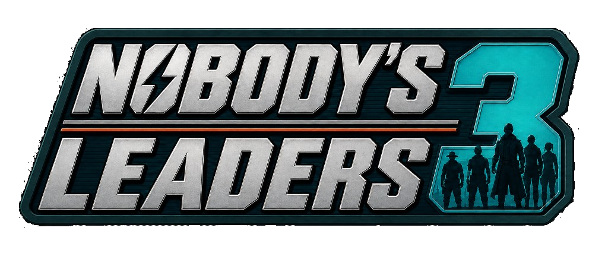

  

  <h1>Nobody's Leaders 3</h1>

  

    <strong>A complete Sim Settlements 2 leader pack and optional modern leader-selection panel.</strong>
  

  

    
    
    
    
  

  

    <a href="#overview">Overview</a> ·
    <a href="#features">Features</a> ·
    <a href="#download-options">Downloads</a> ·
    <a href="#requirements">Requirements</a> ·
    <a href="#installation">Installation</a> ·
    <a href="#support">Support</a>
  

---

## Overview

**Nobody's Leaders 3**, or **NBL3**, is a Sim Settlements 2 Leader Pack and a complete overhaul of Nobody's Leaders 2. It combines Fallout 4, DLC, and Sim Settlements 2 characters in one reviewed roster, with traits chosen to fit each character's role, skills, and personality.

The main ESP registers **146 leader cards** with Sim Settlements 2: **72 Fallout 4 and DLC characters** and **74 characters from Sim Settlements 2, Chapter 2, and Chapter 3**. The [NBL3 Leaders Sheet](https://docs.google.com/spreadsheets/d/1NsPlSrSbldQVzK8Z6ulcnFRZs1woYwue00RaQphGflQ/edit?gid=253869683#gid=253869683) provides the broader character reference, source links, and trait data.

NBL3 can be installed as a traditional leader pack. An optional F4SE and PrismaUI module replaces the City Planner's Desk leader picker with a responsive panel that shows the information needed to choose a leader without changing SS2's assignment rules.

## Features

- Adds 146 registered leader cards across Fallout 4, supported DLC, and all three SS2 chapters.
- Gives every NBL3 leader at least one major or minor trait. Every Fallout 4 leader also has a weakness; a few SS2 leaders have none.
- Shows the traits SS2 applies to each card (major, minor, and weakness) with their SS2 descriptions.
- Checks every leader with SS2 for the settlement being managed and greys out the ones SS2 would refuse, with the reason.
- Shows a details area for the selected leader, with full trait effects, card restrictions, and the current leader's traits for comparison.
- Shows whether a character already leads a settlement.
- Shows settlement restrictions for leaders who can only lead specific settlements.
- Searches leaders by character, trait, assignment, restriction, and pack metadata.
- Filters installed leader packs and can place currently available leaders first.
- Supports fullscreen and windowed layouts from compact displays through 4K and 8K resolutions, with an Interface scale setting from 75% to 200%.
- Pauses the game while the panel is open by default, like SS2's own leader menu.
- Supports Xbox and PlayStation controllers, with on-screen prompts that follow PrismaUI's controller style.
- Lists NBL3 in the Prisma Dock on the ESC menu, with a short description and a Nexus link.
- Provides access to SS2's original Assign Leader menu from inside the panel.
- Includes **Refresh SS2 leader list**, which runs SS2's own leader-card update and reloads the list without closing the panel.
- Shows the full version notes inside the panel.
- Integrates Automatron and Vault-Tec Workshop support through soft-linked scripts without requiring separate DLC support plugins.

### What's new since NBL2

- 146 leader cards, up from NBL2's 70; no NBL2 leader was dropped.
- All 74 recruitable SS2 characters (Chapters 1–3) added; NBL2 had none.
- New Fallout 4 leaders: Ben Gibson and Jezebel. Automatron coverage is now 3 leaders (Ada, Isabel Cruz, Jezebel).
- Fallout 4 traits reworked to fit each character: 61 of the 70 returning leaders changed at least one trait.
- At most one major, one minor, and one weakness per card; every Fallout 4 leader now has both a minor trait and a weakness.
- Card descriptions match each card's actual traits, in one consistent format.
- Single plugin with no DLC masters and no vanilla record edits (NBL2 needed 2 patch plugins and edited 18 vanilla NPCs and 5 cells).
- Safer quest restart and `NBL3:`-namespaced scripts.
- A release validator checks every build against the reviewed roster.
- The Leaders Sheet was rebuilt with SS2 characters and wiki links.
- The Leader Pack is versioned separately from the F4SE module.

## Sim Settlements 2 behavior

NBL3 preserves SS2's leader system. The optional panel reads SS2's registered, available, and dead leader-card lists and follows SS2's normal checks and assignment sequence. Selecting the original SS2 picker takes the same `ShowLeaderSelect` path used by the City Planner's Desk.

Before a leader is assigned, the panel asks SS2's own eligibility check for the settlement being managed, without SS2's messages, so leaders SS2 would refuse are greyed out instead of failing after **Assign**. Assignment still runs SS2's full check and confirmation.

The panel also lists leaders from other installed add-on and leader packs through SS2's normal registration system. Each pack is identified by its pack name and author. NBL3 does not remove or hide another pack's cards by default. NBL3 takes no credit for the leader cards of other add-on or leader packs; all credit goes to their respective authors. NBL3 simply provides a better interface for any leader pack.

Kinggath was informed of the native interception used by the optional panel and granted permission for this approach. SS2 source files are not modified.

## Download options

The [Releases page](https://github.com/NOBOBYoO/NBL3/releases) provides two independently versioned packages. Install only one: the F4SE package already contains the complete leader pack, so do not combine it with the leader pack from GitHub, Nexus Mods, or Bethesda.net.

| Package | PC | Xbox |
| --- | --- | --- |
| SS2 — Nobody's Leaders 3 (Leader Pack) | [GitHub Releases](https://github.com/NOBOBYoO/NBL3/releases), [Nexus Mods](https://www.nexusmods.com/fallout4/mods/108093), [Bethesda.net](https://creations.bethesda.net/en/fallout4/details/02a52796-4dac-4399-8f5a-0016cfe82d2c/Nobody__39_s_Leaders_3) | [Bethesda.net](https://creations.bethesda.net/en/fallout4/details/02a52796-4dac-4399-8f5a-0016cfe82d2c/Nobody__39_s_Leaders_3) |
| NBL3 F4SE | [GitHub Releases](https://github.com/NOBOBYoO/NBL3/releases), [Nexus Mods](https://www.nexusmods.com/fallout4/mods/108093) | Not available |

### SS2 — Nobody's Leaders 3

The traditional leader pack. It contains the main ESP and required Papyrus scripts and uses SS2's standard leader-selection interface. Current pack: [v1.0.0](https://github.com/NOBOBYoO/NBL3/releases/tag/v1.0.0-leader-pack). This version does not move when only the overlay changes.

Also available on Xbox and PC through [Bethesda.net](https://creations.bethesda.net/en/fallout4/details/02a52796-4dac-4399-8f5a-0016cfe82d2c/Nobody__39_s_Leaders_3).

### NBL3 F4SE

The complete leader pack plus the F4SE module, PrismaUI panel, and configuration. Install this package to use NBL3's leader browser. PC only: it requires F4SE and PrismaUI and is not available on Xbox or Bethesda.net. Current module: [v0.4.0](https://github.com/NOBOBYoO/NBL3/releases/tag/v0.4.0-f4se).

SHA-256 checksum files are supplied with every GitHub download so the archives can be verified before installation.

## Requirements

Both packages require:

- [Fallout 4](https://store.steampowered.com/app/377160/Fallout_4/)
- [Workshop Framework](https://www.nexusmods.com/fallout4/mods/35004) **2.5.0 or newer**
- [Sim Settlements 2](https://www.nexusmods.com/fallout4/mods/47976) **3.6.0 or newer**, including Chapters 2 and 3 or the corresponding All Chapters Pack

The F4SE package additionally requires:

- [Fallout 4 Script Extender](https://f4se.silverlock.org/) for the installed game runtime
- [Address Library for F4SE Plugins](https://www.nexusmods.com/fallout4/mods/47327) for the installed game runtime
- [PrismaUI F4](https://www.nexusmods.com/fallout4/mods/105454) **2.2.1.2** (recommended)
- Microsoft Visual C++ 2015–2022 Redistributable

The v0.4.0 native module declares support for Fallout 4 **1.10.163**, **1.10.980**, **1.10.984**, **1.11.137**, **1.11.159**, **1.11.169**, **1.11.191**, **1.11.221**, and **1.11.240**. PrismaUI F4 **2.2.1.2** is recommended; older PrismaUI versions log a warning. NBL3 0.2.0 does not load with PrismaUI 2.1.1 or newer. Install matching versions of F4SE, Address Library, and other runtime-specific dependencies.

## Installation

### Vortex or Mod Organizer 2

1. Install the requirements for the selected package.
2. Download one NBL3 archive from the [Releases page](https://github.com/NOBOBYoO/NBL3/releases).
3. Install and enable it with the mod manager.
4. Confirm that `SS2_NobodysLeaders3.esp` is enabled.
5. With the F4SE package, launch Fallout 4 through F4SE.

Only install one NBL3 package. The F4SE archive already includes the complete leader pack, so do not also install the Bethesda.net leader pack.

### Bethesda.net (Xbox and PC)

The leader pack can be installed from the in-game Creations menu or the [Bethesda.net Creations page](https://creations.bethesda.net/en/fallout4/details/02a52796-4dac-4399-8f5a-0016cfe82d2c/Nobody__39_s_Leaders_3). Install Workshop Framework and Sim Settlements 2 (with Chapters 2 and 3) first. The F4SE panel is not available through Bethesda.net.

### Manual installation

Extract the selected archive into the Fallout 4 `Data` directory while preserving its folder structure, then enable `SS2_NobodysLeaders3.esp`. Launch through F4SE when using the panel package.

### Leader registration

SS2 registers leader packs asynchronously. Newly installed leaders may take several minutes, and heavily scripted saves can require several in-game days. Once a pack is registered, **Refresh SS2 leader list** in the panel runs SS2's own check for which leaders are available; with many leader packs it can take up to half a minute.

## Using the panel

Use **Assign or Replace City Leader** from an SS2 City Planner's Desk. NBL3 intercepts that option and presents the leader panel after the desk message closes.

- Select a card and choose **Assign as leader** (or **Replace with** when the settlement already has a leader) to continue through SS2's normal assignment flow.
- Hover a trait, assignment, or settlement-limit tag to see its description. With a controller, or with **Details area** set to **Always Show**, the selected leader's details appear below the list.
- Use pack filters and search to narrow the roster.
- Choose display mode, interface scale, details area, and pausing in Settings.
- On a controller, the hint strip shows move, cursor, scroll, confirm, close, box, and pack actions.
- Choose **Open original Assign Leader menu** to use SS2's original picker.
- Choose **Refresh SS2 leader list** after recruiting a new settler, so SS2 re-checks which leaders are available.
- Choose **Version Notes** under the version number to read the notes for every release.

## Support

- **Panel does not open:** confirm that Fallout 4 was launched through F4SE and that PrismaUI F4 2.2.1.2 is installed. NBL3 0.2.0 cannot load with PrismaUI 2.1.1 or newer.
- **Leader pack is missing:** confirm that the ESP and every SS2 chapter are enabled, then allow SS2's registration process to finish.
- **A leader remains unavailable:** NBL3 reflects SS2's own availability and settlement checks. The panel shows the reason under the card and in the details area; review the card's restrictions and the character's recruitment state.
- **Log location:** `Documents\My Games\Fallout4\F4SE\NBL3.log`.

When reporting a problem, include the exact Fallout 4 runtime, NBL3 version, `NBL3.log`, `f4se.log`, `PrismaUI_F4.log`, load order, affected leader or settlement, and reproduction steps.

Support for continued development is welcome on Ko-fi.

## AI usage disclosure

AI tools are used during NBL3's development for automation, debugging, image generation, and implementation support. Design decisions, feature direction, review, testing, and release responsibility remain under the author's supervision.

## Credits

- [Sim Settlements 2](https://www.nexusmods.com/fallout4/mods/47976) — kinggath and the Sim Settlements 2 Team
- [Workshop Framework](https://www.nexusmods.com/fallout4/mods/35004) — kinggath
- [PrismaUI F4](https://www.nexusmods.com/fallout4/mods/105454) — StarkMP; Fallout 4 port by NomadsReach / Fallen World
- [Fallout 4 Script Extender](https://f4se.silverlock.org/) — Ian Patterson, Stephen Abel, and Brendan Borthwick
- [Address Library for F4SE Plugins](https://www.nexusmods.com/fallout4/mods/47327) — meh321
- [Independent Fallout Wiki](https://fallout.wiki/wiki/Fallout_Wiki) — Fallout character references
- [Sim Settlements 2 Wiki](https://wiki.simsettlements2.com/) — SS2 leader-system references

## Repository notice

This public repository contains NBL3 release information and approved player downloads. NBL3's source code is maintained privately and is not distributed from this repository.

See [LICENSE](LICENSE) for the terms that apply to the public release files.

---

  <strong>Nobody's Leaders 3</strong> 
  Choose the right leader without leaving SS2's rules behind.  
  <a href="https://github.com/NOBOBYoO/NBL3/releases">Releases</a> ·
  <a href="https://docs.google.com/spreadsheets/d/1NsPlSrSbldQVzK8Z6ulcnFRZs1woYwue00RaQphGflQ/edit?gid=253869683#gid=253869683">Leader Sheet</a>

